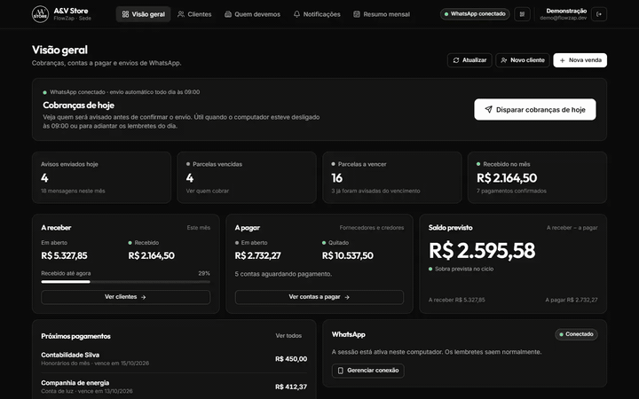
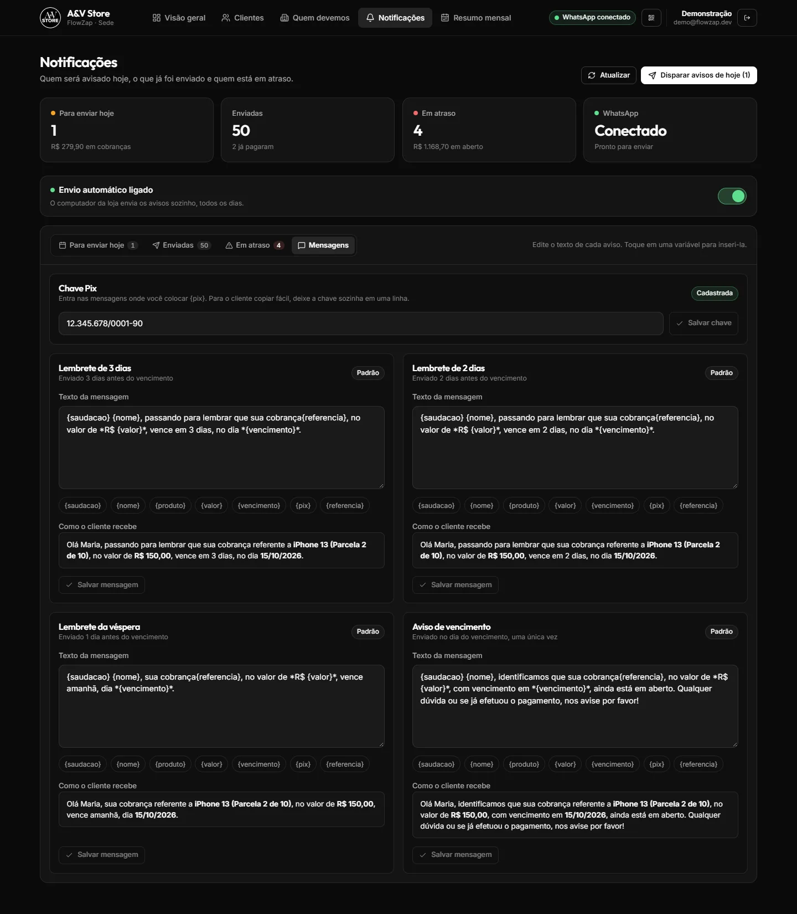
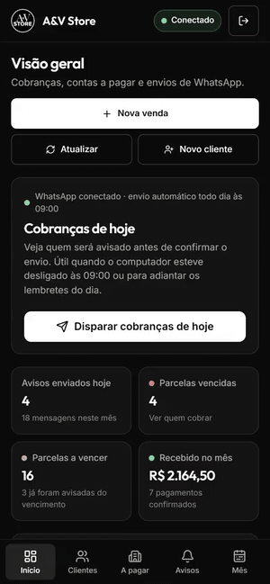

# Flow-Zap — Automated Installment Collection via WhatsApp

> Web system for a phone store that sells on in-store installments: it sends payment reminders over WhatsApp on its own and shows the owner exactly how much comes in and goes out each month.

  

> All images use a demo store with fictitious customers, amounts and phone numbers.

## Highlights

<!-- XYZ: "Accomplished [X] as measured by [Y], by doing [Z]". Troque/adicione números de negócio que o cliente autorizar. -->

- **Automated the store's entire collection routine**, as measured by 4 reminders per installment (3, 2 and 1 day before and on the due date) sent with no human action, by building a daily scheduler with a WhatsApp send queue that recovers missed runs when the computer is turned on.
- **Eliminated duplicate messages to customers**, as measured by idempotency guaranteed per sale, reminder type and cycle (and covered by tests), by logging every send and checking the log before sending instead of trusting "the routine already ran".
- **Delivered a production system with zero server cost**, as measured by running on Vercel + Supabase free tier + the store's own PC, by designing a hybrid architecture where the same API runs in the cloud and on-site behind a WhatsApp gateway interface.
- **Kept regressions out while shipping fast**, as measured by 347 automated tests in ~4 weeks, by writing tests first and keeping repositories and WhatsApp behind interfaces so tests run without a database or network.

## The story (STAR)

### Situation

The store sells phones and accessories in installments directly to customers, without credit cards. Collecting was manual: open a spreadsheet, check who was due that week, send WhatsApp messages one by one and try to remember who had already been reminded. Payments were late because nobody remembered to charge, and the owner had no clear view of the month's cash flow.

### Task

Build a system that collects on its own over WhatsApp without getting the store's number banned, organizes who owes what, shows the month's cash flow, and runs without paying for a server.

### Action

- **Hybrid architecture:** WhatsApp needs a connection that stays open all the time, which doesn't fit serverless. The panel and API run on Vercel (accessible from anywhere); the same API runs on the store's computer with WhatsApp, the daily routine, the send queue and backups, sharing one Supabase database.
- **Dependency inversion:** services depend on an `IWhatsAppGateway` interface, not on Baileys. The store PC injects the real gateway, Vercel injects one that answers "unavailable", and a demo mode runs the real API on in-memory repositories with a fake WhatsApp.
- **Anti-ban queue:** sequential FIFO, random 8–20 s gaps, "typing..." indicator, varying greetings (custom templates without one are rejected), number check before sending, and waiting for reconnection instead of failing.
- **Only one "headquarters":** an atomic conditional write in the database guarantees a single machine sends messages. Switching machines is always a human decision.
- **Dates done right:** "mark as paid" adds exactly one month, respecting 28–31 day months and keeping the original due day; months are counted in Brazil time (UTC-3) even on UTC servers.
- **Free tier without losing data:** daily JSON backups on the store PC (keeping 30), an empty database never overwrites backups, restore needs `--confirm`, and the PC's heartbeat keeps the Supabase project awake.
- **Interface for non-technical users:** one main button per screen, color only for status and always with a label, confirmations that show who, what and how much, and full keyboard navigation.

### Result

- Collection went from a daily manual task to something that runs by itself every morning.
- The owner sees received, receivable, bills and balance for the month on one screen, with a 6-month trend.
- The store's data is backed up daily, exportable to PDF/JSON and restorable from the command line.

<!-- Adicione resultados medidos e autorizados pelo cliente, ex.: "inadimplência caiu de A% para B%", "X horas/semana economizadas". -->

## Tech stack

React 19 · TypeScript (strict) · Vite · Node.js / Express · Zod · Supabase (PostgreSQL) · Baileys (WhatsApp) · node-cron · Vitest · esbuild · Vercel

## Screenshots

| Customers | New sale |
| --- | --- |
|  |  |

| Editable messages | Monthly summary |
| --- | --- |
|  |  |

| Mobile walkthrough | Mobile: overview | Mobile: customer |
| --- | --- | --- |
|  |  |  |

## About this repository

The source code is private due to client confidentiality. This page documents the project, my role and the decisions behind it.
Want something similar for your business? [Get in touch](https://schaidenunes.com/).

**My role:** Full-stack developer, solo project, from requirements to deploy and on-site setup
**Duration:** ~4 weeks (September – October 2026, 90 commits)
